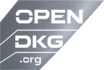

<p align="center">
  
</p>

<h1 align="center">OpenDKG Websites</h1>

<p align="center">
  Public monorepo for <a href="https://opendkg.org/">opendkg.org</a>, the <a href="https://opendkg.org/apps/">OpenDKG Apps Directory</a>, and standalone project sites built and deployed to Cloudflare Pages.
</p>

---

## Overview

`OpenDKG/Websites` brings together the OpenDKG umbrella website and its standalone project websites in a single static, zero-dependency repository. Every site is pure HTML, CSS, and minimal progressive-enhancement JavaScript where needed — with **zero cookies**, **zero analytics**, **zero external font/CDN requests**, and strict per-route `Content-Security-Policy` headers.

## Published Sites & Routes

`scripts/build.mjs` assembles `opendkg.org/public/` together with each standalone project folder into `dist/` (excluding repository housekeeping files such as `README.md`, `.gitignore`, `.gitattributes`, and `.github/`):

| Source folder | Live route | Theme & focus |
| --- | --- | --- |
| [`opendkg.org/`](opendkg.org/) | [`https://opendkg.org/`](https://opendkg.org/) | OpenDKG umbrella homepage, [`/apps/`](https://opendkg.org/apps/) free software directory, [`/transparency/`](https://opendkg.org/transparency/), [`/donate/`](https://opendkg.org/donate/), [`/privacy/`](https://opendkg.org/privacy/), and project summaries |
| [`axiom/`](axiom/) | [`https://opendkg.org/axiom/`](https://opendkg.org/axiom/) | **Axiom** — Titanium/graphite security site covering agent-first protection, local firewall/DNS controls, and `/axiom/pentesting` evidence |
| [`Desktop/`](Desktop/) | [`https://opendkg.org/desktop/`](https://opendkg.org/desktop/) | **OpenDKG Desktop** — Obsidian Dark Teal site for the `127.0.0.1:4820` AI gateway, 3-layer agent memory, Spend Guard, and OT-RFC-27 hub |
| [`Graph/`](Graph/) | [`https://opendkg.org/graph/`](https://opendkg.org/graph/) | **DKG Graph Local** — Dark Glass Sapphire & Mint site for the zero-gas DKG `v10.1.2` Working Memory vault, WASM Graph Computer, and MCP `:3847` |
| [`VerityTrail/`](VerityTrail/) | [`https://opendkg.org/veritytrail/`](https://opendkg.org/veritytrail/) | **VerityTrail** — Graphite Dark & Steel Blue site for the local security assurance lab, SAST/SBOM, isolated VM/WSL2 runs, and read-only AI audits |

## Architecture & Privacy

- **Zero runtime dependencies:** Built using Node.js built-ins only (`scripts/build.mjs`).
- **Self-hosted assets only:** Fonts (`Archivo`, `Manrope`, `Space Grotesk`), icons, screenshots, and brand marks are served from the same origin.
- **Strict CSP (`opendkg.org/public/_headers`):**
  - `/*` and `/donate/*` block inline styles and external frames (`default-src 'none'; script-src 'self'; style-src 'self'; img-src 'self'; font-src 'self'`).
  - `/axiom/*`, `/desktop/*`, `/graph/*`, and `/veritytrail/*` carry tailored policies allowing their self-hosted scripts and fonts (and `youtube-nocookie.com` video embeds on `/axiom/*` only when clicked).
- **Zero tracking:** No cookies, no analytics beacons, and a dismissible local-storage privacy notice across all routes.

## Repository Layout

```text
opendkg.org/            Umbrella site, /apps/ directory, CSP _headers, link checker & tests
  public/               Static root files served at / (including apps/, transparency/, donate/, privacy/)
  scripts/              Exact-case route, anchor, metadata, and sitemap checker
  test/                 Automated Node test suite (links, CSP headers, Axiom & project-site checks)
axiom/                  Axiom project site -> dist/axiom/
Desktop/                OpenDKG Desktop site -> dist/desktop/
Graph/                  DKG Graph Local site -> dist/graph/
VerityTrail/            VerityTrail site -> dist/veritytrail/
scripts/
  build.mjs             Assembles opendkg.org/public/ and project folders into dist/
.github/workflows/
  ci.yml                Builds dist/, runs link checks, and executes all Node tests on push & PR
dist/                   Generated Cloudflare Pages output (gitignored)
```

## Local Preview & Verification

Requires Node.js 22+ (no `npm install` needed):

```sh
# 1. Build the unified dist/ output
node scripts/build.mjs

# 2. Validate internal links, exact route casing, anchors, metadata, and sitemap.xml
node opendkg.org/scripts/check-links.mjs dist

# 3. Run the automated test suite (links, CSP headers, project sites, release claims)
node --test opendkg.org/test/*.test.mjs

# 4. Preview locally
python3 -m http.server 8080 -d dist
```

Then open `http://127.0.0.1:8080/` (or `/apps/`, `/axiom/`, `/desktop/`, `/graph/`, `/veritytrail/`).

## Deployment (Cloudflare Pages)

Cloudflare Pages builds directly from `main` in `OpenDKG/Websites`:

- **Build command:** `node scripts/build.mjs`
- **Build output directory:** `dist`
- **Root directory:** *(repository root)*

Every push to `main` builds the full multi-site tree into `dist/` and updates `https://opendkg.org/`.

## Contributing, License & Independence

- See [CONTRIBUTING.md](CONTRIBUTING.md) and the organization guidelines in [OpenDKG/.github](https://github.com/OpenDKG/.github).
- Original website code in this repository is licensed under **Apache-2.0**; see [LICENSE](LICENSE) and [THIRD_PARTY_NOTICES.md](THIRD_PARTY_NOTICES.md).
- OpenDKG is an independent open-source initiative. Optional integrations with third-party technologies (such as OriginTrail DKG or Umanitek Agent Blackbox) do not imply affiliation, endorsement, or joint ownership.
